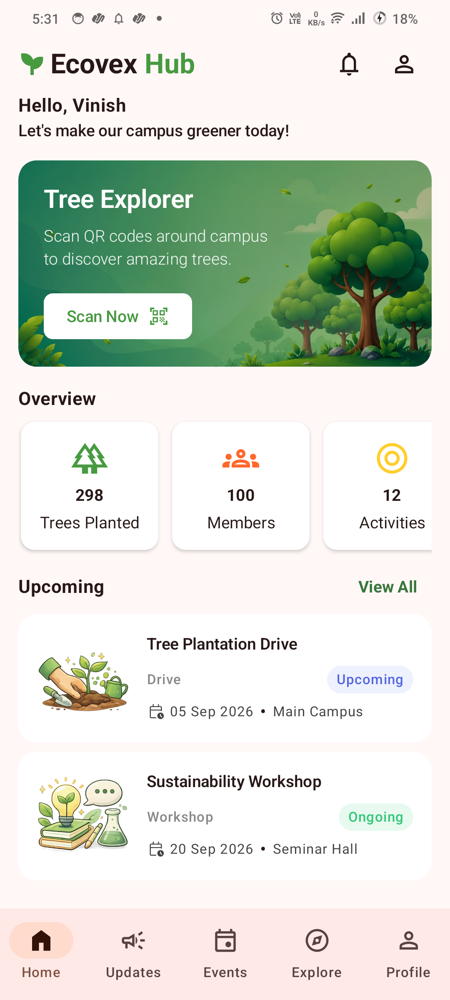
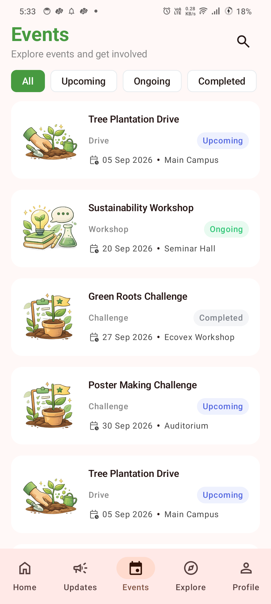
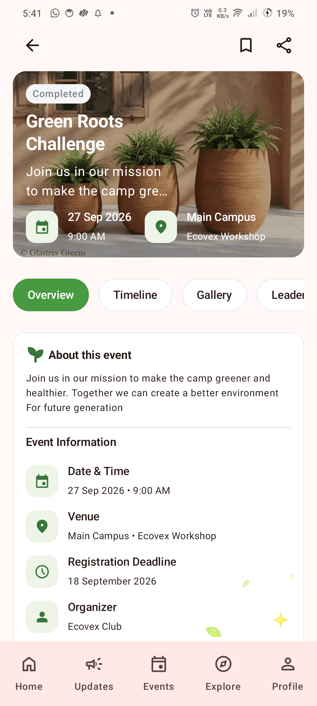
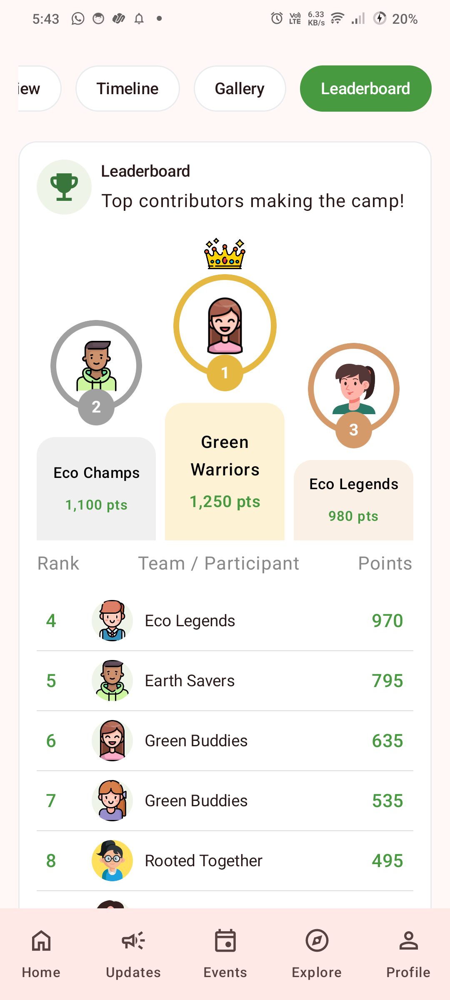
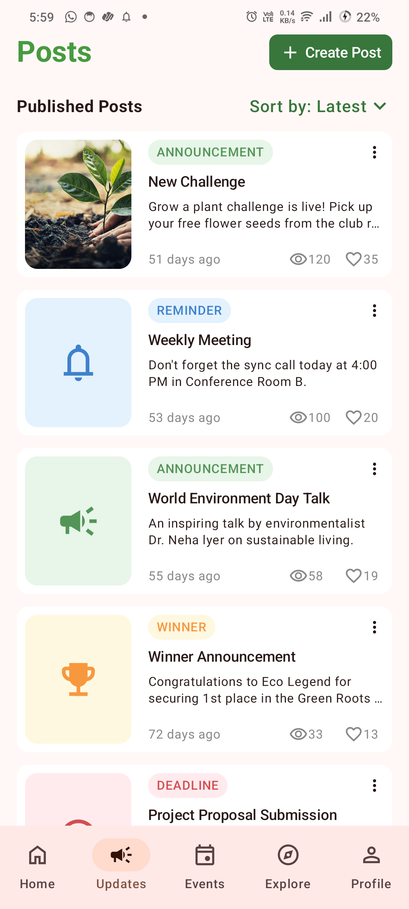
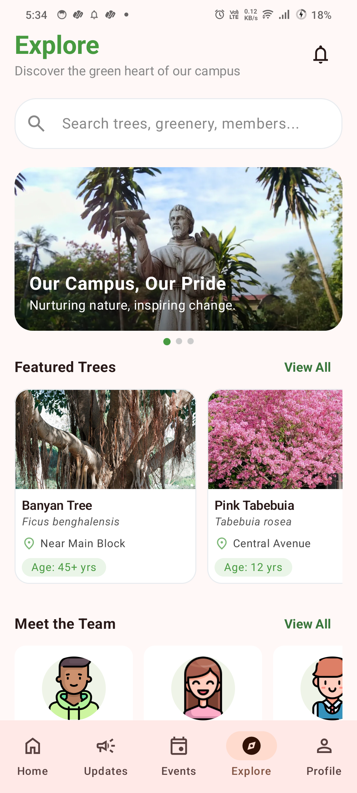
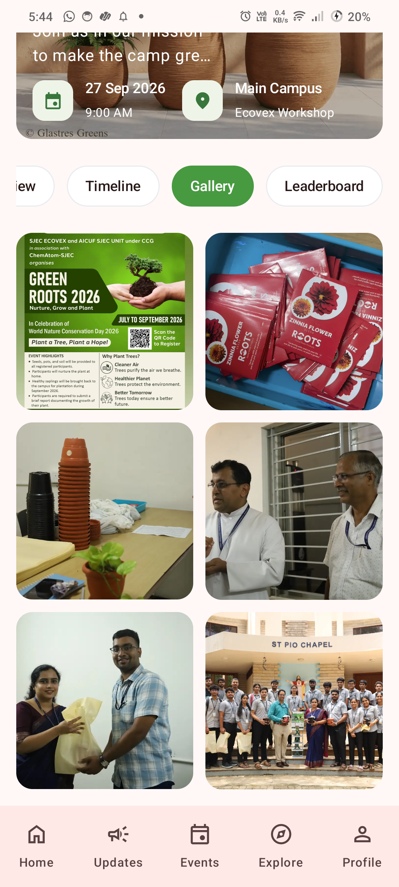
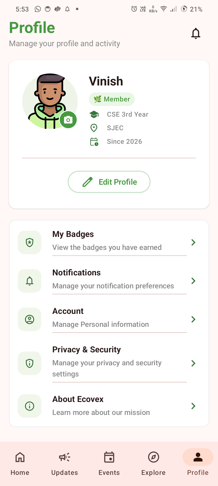

# Ecovex Hub 🌿

A campus sustainability app built with **Kotlin and Jetpack Compose** for the Ecovex Club at St Joseph Engineering College.

Ecovex Hub brings campus events, club announcements, sustainability initiatives, and member information together in one place.

## Screenshots

<!-- Replace the placeholders with your screenshots -->

  
  &nbsp;
  
  &nbsp;
  

  
  

  &nbsp;
  
  &nbsp;
  &nbsp;
  
  &nbsp;
  

## Features

- **Home** — Overview of club activities and upcoming events.
- **Updates** — Announcements, reminders, and winner announcements.
- **Events** — Event details, timelines, galleries, and leaderboards.
- **Explore** — Campus trees, club members, and sustainability tips.
- **Profile** — Member information and preferences.

## Tech Stack

- Kotlin
- Jetpack Compose
- Material 3
- Navigation Compose

## Project Status

Currently under development.

## Getting Started

1. Clone the repository.
2. Open the project in Android Studio.
3. Sync Gradle and run the app on an emulator or Android device.

## License

To be decided.
